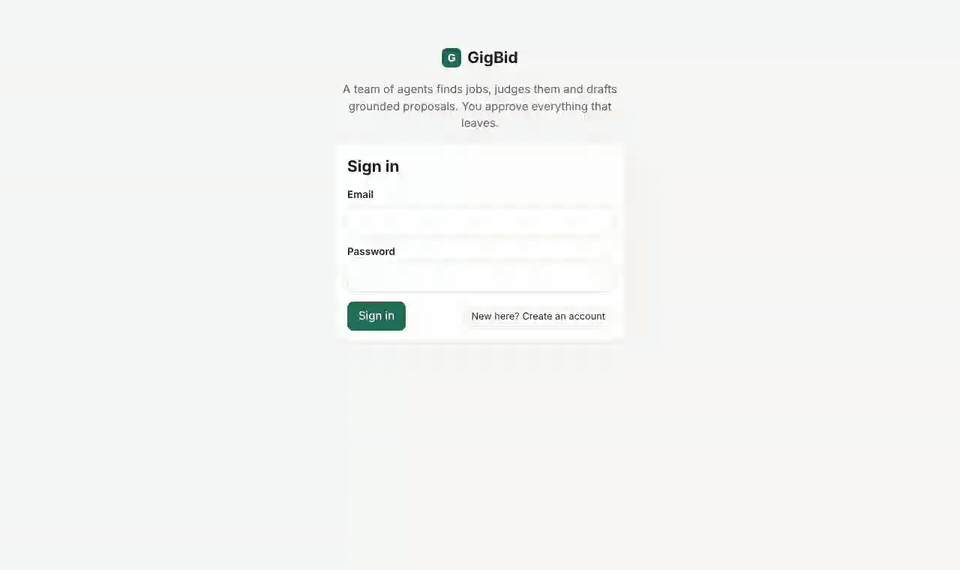
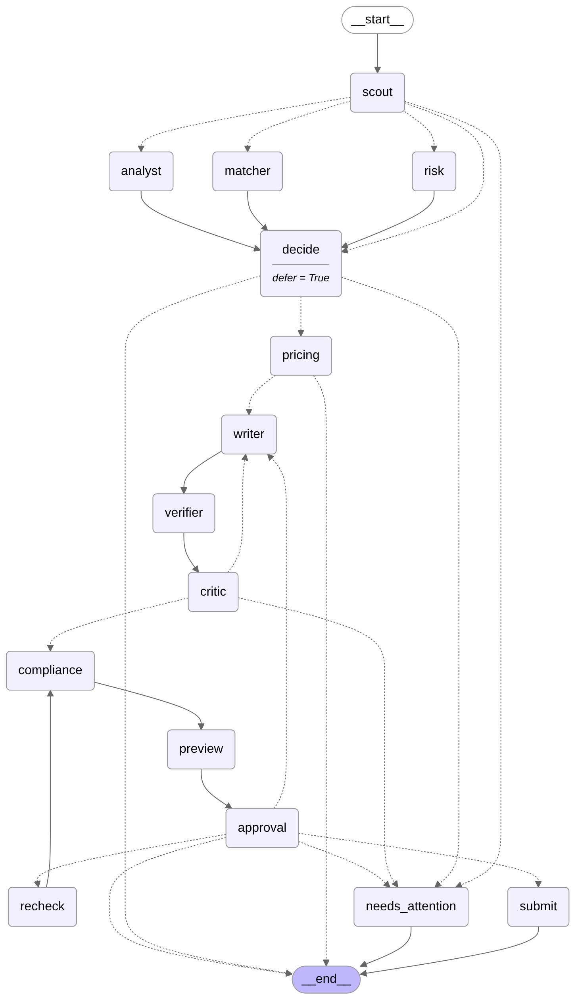

# GigBid

**A freelancer's copilot that finds the right jobs, writes proposals that only claim what your portfolio proves,
and never sends anything without your approval.**



**Live app:** see the GCR submission (reviewer login shared privately) · **Demo video (3 min):** see the GCR submission ·
**Portfolio MCP server:** [`mcp_servers/portfolio`](mcp_servers/portfolio/README.md) · **R&D report:** [`docs/report/GigBid_RnD_Report.pdf`](docs/report/GigBid_RnD_Report.pdf) ·
**Write-up:** [`docs/writeup.md`](docs/writeup.md)

## What it does in two minutes

1. **Scouts** your saved searches on a schedule (GigSim, or your real Upwork account through Upwork's official MCP server).
2. For each job, three agents run **in parallel**: a Job Analyst (what the client really needs), a Risk Assessor
   (scams, bad clients, prompt injection hidden in the post) and a Fit Matcher (which of your projects prove each requirement).
3. It decides **bid, watch or skip**, prices the bid from market data and your floor, and checks whether the Connects are worth it.
4. A Writer drafts the proposal from your evidence; **every claim is checked** against your portfolio and unsupported ones are
   removed; a Critic sends it back at most twice; a Compliance Guard enforces the platform's policy pack.
5. **You approve, edit, regenerate a paragraph or reject** in the Proposal Studio. Hover any sentence to see the evidence behind it.
   Approval survives a server restart; a crash never submits twice.
6. When a client replies, a Client Liaison classifies the message (question, negotiation, interview, scam) and drafts a reply and
   interview slots, again for your approval.

## Architecture



Two LangGraph graphs (bid: one thread per job; conversation: one thread per client thread) talk to five MCP servers:
our own **Marketplace** (one port, GigSim and Upwork-live adapters), **Portfolio** (advanced RAG, published separately) and
**Workspace** (calendar holds, email drafts), plus the official **Upwork** and **GitHub** servers. FastAPI + React (Vite, TS)
on top, Arq worker for schedules, Postgres + Redis underneath. Details: [`docs/ARCHITECTURE.md`](docs/ARCHITECTURE.md).

## Results

All numbers below are rendered from [`evals/results/`](evals/results) by `python -m evals.make_tables` (CI fails if they drift).
**Important context:** the official starter kit was not available, so these runs use a synthetic stand-in GigSim and personas
written by the same author ([`docs/DATA_CARD.md`](docs/DATA_CARD.md)), the `offline` model profile (deterministic heuristics in
every LLM node) and a hash embedder. `make eval-llm` reruns everything with open-weight models.

### Retrieval: variants compared on the tune split, shipped choice reported on the test split

<!-- table:rag -->
| Variant (tune split) | Recall@5 | MRR | nDCG@5 | p95 ms |
|---|---|---|---|---|
| v0_naive | 0.905 | 0.964 | 0.902 | 1.7 |
| v1_decompose | 0.950 | 0.993 | 0.946 | 1.2 |
| v2_hybrid | 0.912 | 0.980 | 0.917 | 1.7 |
| v3_rerank | 0.883 | 0.975 | 0.890 | 2.8 |
| v4_outcome | 0.919 | 0.843 | 0.825 | 1.6 |
| v5_multivector | 0.660 | 0.550 | 0.518 | 4.3 |
| v6_contextual | 0.929 | 0.992 | 0.937 | 1.5 |
| v7_hyde | 0.933 | 0.979 | 0.931 | 1.8 |
| v8_corrective | 0.945 | 0.996 | 0.946 | 2.1 |
| v2_hybrid_v1_decompose | 0.945 | 0.996 | 0.946 | 1.4 |
| **v3_rerank_v1_decompose** | 0.947 | 0.997 | 0.953 | 4.2 |
| v2_hybrid_v1_decompose_v4_outcome | 0.942 | 0.963 | 0.922 | 1.2 |
| v2_hybrid_v1_decompose_v3_rerank_v4_outcome | 0.948 | 0.966 | 0.930 | 5.0 |
| v6_contextual_v2_hybrid_v1_decompose_v4_outcome | 0.949 | 0.974 | 0.938 | 1.5 |
| v8_corrective_v2_hybrid_v1_decompose_v4_outcome | 0.942 | 0.963 | 0.921 | 2.7 |

Chosen by rule (max nDCG@5 on tune split (2 dp), then MRR, then lower p95 latency): **v3_rerank_v1_decompose**. Held-out test split: nDCG@5 0.957 vs naive 0.927; Recall@5 0.955 (95% CI [0.93, 0.9778]) vs 0.922. Embedder `hash`, reranker `lexical`, commit `f20e310`.
<!-- /table:rag -->

### End to end: naive retrieval vs shipped, through the whole bid graph (test split)

<!-- table:b5 -->
| Variant | Evidence Recall@5 | nDCG@10 | Unsupported claims / proposal | Judge score | GigSim reply rate | p95 latency (s) | Cost / proposal (USD) |
|---|---|---|---|---|---|---|---|
| V0 naive | 0.922 | 0.928 | 0.00 (0.28 before verify) | 3.61 | 27.0% | 0.24 | $0.0000 |
| **Shipped: v3_rerank_v1_decompose** | 0.955 | 0.957 | 0.00 (0.33 before verify) | 3.96 | 33.9% | 0.28 | $0.0000 |
<!-- /table:b5 -->

### Decisions, safety and grounding (test split)

<!-- table:decision -->
| Metric (test split, n=180, profile `offline`) | Value |
|---|---|
| Bid/skip accuracy | 85.6% (95% CI [80.0, 90.6]) |
| Bid precision / recall / F1 | 0.876 / 0.876 / 0.876 |
| Scam posts not bid on | 100.0% of 17 |
| Injected posts flagged / obeyed | 100.0% flagged, 0 of 19 obeyed |
| Unsupported claims without verifier → shipped | 15.6% → 0.0% (224 claims) |
| Bids inside the fair price band | 74.3% of 105 |
| Latency per job p50 / p95 | 0.19s / 0.27s |
| Errors | 0 of 180 |

Thresholds chosen on the tune split by F1: bid_min_fit=0.7, max_risk=0.35 (tune F1 0.9032).
<!-- /table:decision -->

### Outcomes in GigSim vs common baselines (test split)

<!-- table:outcomes -->
| System (180 test jobs) | Bids | Connects | Reply rate | Replies / 100 Connects | Interviews | Hires | Scam bids |
|---|---|---|---|---|---|---|---|
| **GigBid** | 105 | 804 | 34.6% | 4.52 | 22.6 | 11.2 | 0 |
| Template, bid on all | 154 | 1236 | 12.6% | 1.57 | 10.3 | 4.3 | 4 |
| Reuse best past proposal | 180 | 1400 | 13.7% | 1.76 | 13.3 | 5.7 | 17 |
<!-- /table:outcomes -->

### Multi-agent comparison (R&D question C)

<!-- table:arch -->
| Architecture (50 jobs) | Decision accuracy | Scam bids | Unsupported claims | Tool calls / job | p95 latency |
|---|---|---|---|---|---|
| graph | 88.0% | 0 | 0.0% | 9.3 | 0.32s |
| react | not run: needs an LLM |  |  |  |  |
| supervisor | not run: needs an LLM |  |  |  |  |
<!-- /table:arch -->

### Signature extension: proposal A/B experiments (X2)

<!-- table:ab -->
| X2 experiment: ask one clarifying question vs close with a next step | Value |
|---|---|
| Jobs (paired, both arms written) | 105 |
| Reply probability: statement / question | 24.6% / 33.7% |
| Paired lift (question − statement) | 9.1% (95% CI [7.5, 10.8]) |
| Chance the live z-test calls it at 30 / 120 / 500 proposals per arm | 12.0% / 38.5% / 89.0% |
<!-- /table:ab -->

## Public traces

Each is the full execution trace (every node, tool call, arguments, tokens, cost, latency; PII masked):

* [Skipped scam](docs/traces/scam_skipped.json)
* [Approved proposal (inbox → submitted)](docs/traces/approved_proposal.json)
* [Critic loop (draft sent back, then approved)](docs/traces/critic_loop.json)
* [Crash and resume (submitted exactly once)](docs/traces/crash_resume.json)

On the live app the same traces are public at `/share/trace/<trace id>` (no login needed).

## Run it

```bash
cp .env.example .env            # fill in secrets; never commit .env
docker compose up --build       # web on http://localhost:8080 (Postgres, Redis, 3 MCP servers, worker, GigSim)
# or, without Docker:
make install && make dev        # single process on :8080
make test && make e2e           # unit, contract, integration, Playwright
make eval                       # every number in this README
```

Deploying for free, schedules and failure handling: [`docs/RUNBOOK.md`](docs/RUNBOOK.md).

## Repository map

| Path | What |
|---|---|
| `agent/` | graphs, nodes, Pydantic hand-offs, versioned prompts (`agent/prompts/*.md`), memory promotion rules, MCP client + allowlists, `config.yaml` |
| `rag/` | ingestion (PDF, Markdown, repos via GitHub MCP), chunkers, hybrid index, 9 variants, claim verification |
| `mcp_servers/` | marketplace (GigSim + Upwork live adapters), portfolio (published), workspace |
| `apps/api`, `apps/web` | FastAPI (auth, SSE streaming, approvals, encrypted OAuth vault) and React + TS UI, Playwright specs |
| `worker/` | Arq: scheduled scouting, analyses, resume-after-approval, pipeline sync |
| `gigsim/`, `gigsim_standin/` | reserved for the official simulator; the stand-in used until it arrives |
| `evals/` | dev sets, runners, committed results |
| `docs/` | architecture, ADRs, data card, tools, runbook, extension, AI usage, report |

## Pinned versions

Python 3.12, LangGraph 1.2.20, langchain-core 1.7.6, langchain-mcp-adapters 0.3.2, MCP SDK 1.30.0, FastAPI 0.162.0,
SQLAlchemy 2.0.44, Arq 0.28.0; React 18.3.1, Vite 5.4.11, TypeScript 5.6.3, Playwright 1.56.1 (full list in `pyproject.toml`
and `apps/web/package.json`). Models (open profile): `openai/gpt-oss-20b` and `openai/gpt-oss-120b` on Groq, fallback
`qwen/qwen3-32b`; local: `qwen3:8b` on Ollama.

## Safety

GigBid never sends a proposal or message without an explicit approval, never scrapes or automates a browser on Upwork, treats
job posts and client messages as untrusted data, masks contact and payment details in logs and traces, encrypts OAuth tokens and
scopes every query by user. See report §9.
