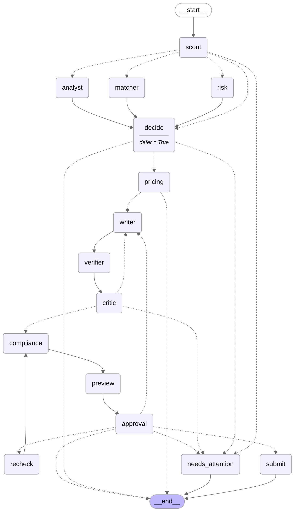
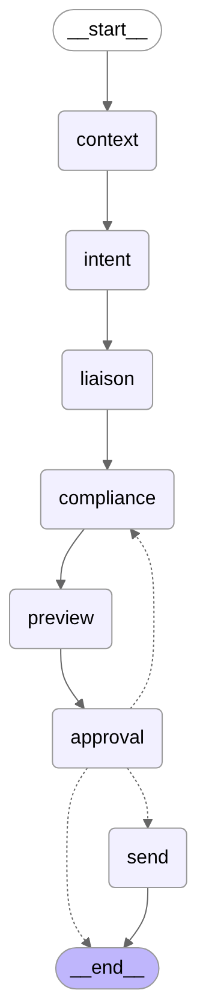

# Architecture

GigBid is a freelancer's copilot: it finds jobs, decides which are worth Connects, writes proposals grounded in
the freelancer's own work, and handles client replies. **A human approves every proposal and every message
before it is sent.** Nothing in the code path can send without passing the approval interrupt.

```
 Browser (React + TS, Vite) ──HTTPS + SSE──▶ FastAPI (apps/api) ──enqueue──▶ Arq worker (worker/)  ◀── cron: saved searches
        ▲  approvals, edits, live progress        │  sessions, OAuth vault,        │
        │                                         │  trace id per request          ▼
        └──────── /api/runs/{id}/stream ◀── Redis pub/sub ◀──────────── LangGraph runtime (agent/)
                                                                 bid graph (1 thread / job)
                                                                 conversation graph (1 thread / client thread)
                                                                 checkpoints: Postgres (SQLite locally)
                                                                 store: style + outcome memory
                                                                        │ MCP (Streamable HTTP, bearer service tokens)
                    ┌───────────────────────────────┬───────────────────┼───────────────────────┬─────────────────────┐
                    ▼                               ▼                   ▼                       ▼                     ▼
          Marketplace MCP (own)            Portfolio MCP (own,    Workspace MCP (own)    Upwork MCP (official)   GitHub MCP (official)
          one port, two adapters:          published separately)  calendar holds,        via the live adapter     repo ingestion
          GigSim | Upwork live             RAG over the portfolio email drafts            (OAuth 2.1 + PKCE)       (read-only token)
```

Rendered from code (`build_bid_graph().compile().get_graph().draw_mermaid()`):

| Bid graph | Conversation graph |
|---|---|
|  |  |

## The marketplace port (R1)

`agent/marketplace_port.py` defines one `MarketplacePort` protocol. Agents never see it directly: they call the
**Marketplace MCP server** (`mcp_servers/marketplace/server.py`), whose tools call the port. Two adapters
implement it: `adapters/gigsim.py` (HTTP to the simulator, retries, `Retry-After`, 5xx handling) and
`adapters/upwork_live.py` (the official Upwork MCP server through `langchain-mcp-adapters`, per-user OAuth
tokens, drafts only). Switching is configuration (`marketplace.mode` / per-user setting), not code.

## Agents and why each exists

| Agent (node) | Exists because | Input → output (Pydantic, `agent/handoffs.py`) | Tools (allowlist in `agent/mcp_client.py`) |
|---|---|---|---|
| Scout | dedupe and fingerprint reposts before spending model calls | search hit → job | search_jobs, get_job, list_events |
| Job Analyst | the stated skills are not the real need; hidden needs drive the pitch | job → `JobSpec` | none (pure reasoning on sanitised text) |
| Risk Assessor | scams and bad clients cost Connects and safety; must run before any writing | job + client history → `RiskReport` | get_client_history, get_job |
| Fit Matcher | a bid needs evidence per requirement, not a vibe | JobSpec → `FitReport` (requirement × evidence matrix) | search_evidence, get_case_study, list_skills |
| decide | one explainable place for skip / watch / bid (thresholds from the eval sweep) | three reports → `BidDecision` | none |
| Pricing Strategist | price from market percentiles, fit and the user's floor; Connects expected value | → `PriceQuote` | get_market_stats, get_connects_balance, get_policy |
| Proposal Writer | drafts from evidence only; obeys learned style rules and A/B arm | → `ProposalDraft` | search_evidence, get_case_study |
| verifier | unsupported claims are removed before anyone sees them | draft → draft + claim labels | search_evidence, get_case_study, list_skills |
| Critic | bounded revision loop (max 2) on specificity, length, opening | draft → `Critique` | search_evidence |
| Compliance Guard | policy pack rules (contacts, off-platform payment, guarantees, free work, length, policy v2) | → `ComplianceVerdict` | none |
| Client Liaison | conversation intent (question, negotiation, interview, scam) and reply drafting with a walk-away floor | messages → `MessageIntent`, `ReplyDraft` | list_messages, search_evidence, free_slots, create_interview_hold, create_email_draft |

Write tools (`create_proposal_draft`, `submit_proposal`, `send_message`) belong only to the **executor**, which
runs after the approval interrupt returns "approve". No agent holds them.

Analyst, Risk and Matcher run in parallel with `Send`; `decide` is a deferred node that waits for all three.
Retries and timeouts are per node (`RetryPolicy`), cheap nodes have a fallback model, and failures land in
`needs_attention` plus the `dead_letter` table.

## State, trace and memory are kept apart (C2)

* **State** (`agent/state.py`, `BidState` / `ConversationState`): what this job needs now. Separate fields for
  job, spec, risk, fit, evidence, decision, price, draft, critiques, compliance, approval, submission, outcome;
  `operator.add` reducers where parallel branches write (`node_log`, `critiques`, `edits`).
* **Execution trace** (`core/tracing.py`, table `trace_spans`, optional Langfuse): every node, model call and
  MCP tool call with arguments, result size, tokens, cost and latency, PII-masked. One trace id flows from the
  UI request header (`x-gigbid-trace-id`) through the API, the graph, every MCP server and the audit log.
* **Long-term memory** (`agent/memory/`, a LangGraph store): only promoted knowledge.
  *Style memory* learns from the user's edits: a rule is promoted only when the same edit pattern appears in
  two or more different drafts. *Outcome memory* records what got replies per job category: an insight is
  promoted only after at least three outcomes with a clear reply-rate gap. Raw tool output never goes in.
  Both are visible and deletable in Settings.

## Human in the loop and durability (R4)

`approval` calls `interrupt()` with the draft, the evidence behind every claim, the risk report, the exact
dry-run payload and the Connects cost. The UI's decision (approve / edit / reject with reason / regenerate a
paragraph) is first persisted as `decided`, then the thread is resumed. Edits go back through claim labelling
and the Compliance Guard. Idempotency keys are derived from thread + draft version + edit count, so a crash
between "submit" and "checkpoint" re-runs the submit and gets the first result back instead of spending
Connects twice (tested in `tests/integration/test_bid_graph.py::test_crash_and_resume_submits_exactly_once`).
On worker start, `recover_decided` finishes approvals that were decided but not completed.

## Stores

| Store | Local | Docker / production |
|---|---|---|
| App DB (users, sessions, jobs, runs, approvals, audit log, pipeline) | SQLite (WAL) | Postgres 16 (pgvector image) |
| Checkpoints | SQLite file next to the DB | Postgres (`AsyncPostgresSaver`) |
| Memory store | SQLite file next to the DB | Postgres (`AsyncPostgresStore`) |
| Vector + BM25 index | in-process per persona / user | same (rebuilt on upload/delete) |
| Events / queue | in-memory | Redis (Arq + pub/sub) |

The audit log is append-only (database triggers reject UPDATE and DELETE).
